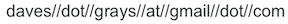

AI researcher and engineer. Former neuroscientist.

Interested in applications of AI to life sciences. Currently working on de novo protein design.

You can read a few of my random thoughts in the blog here. It is just for fun.

Other things I do for fun: writing, drawing, skiing, bike touring, and pretending to bike tour while taking the train with my bike :)

